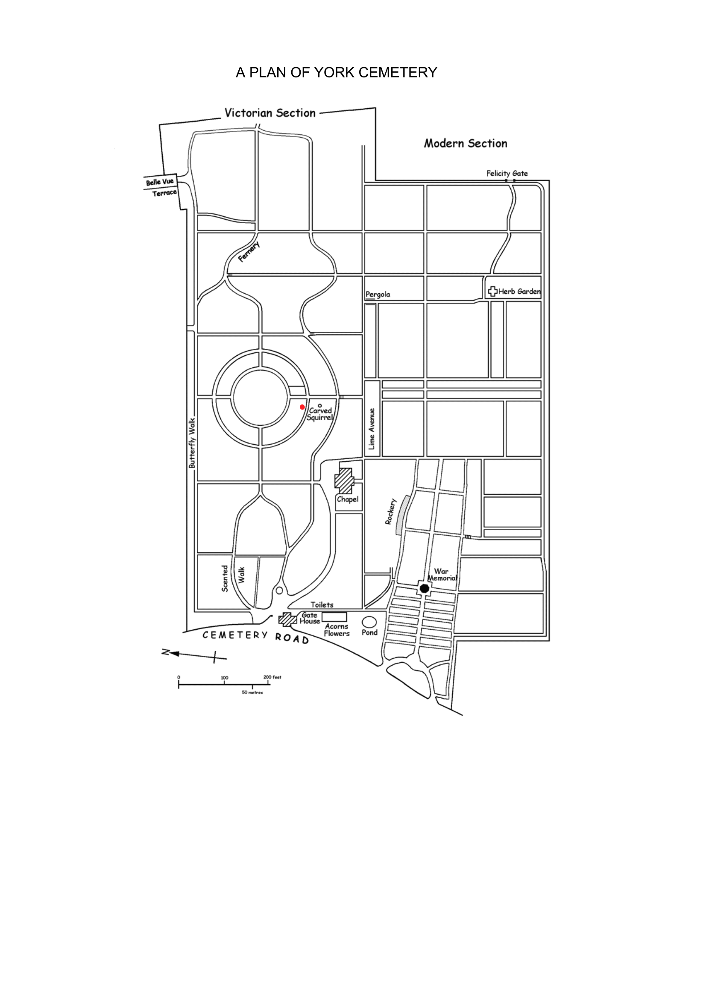

Well at last, Cindy\'s gravestone has been put up in the cemetery. We
all went this afternoon after Meeting, had a look at it and lit some
candles Pat and Maurice had sent for Cindy\'s anniversary and birthday.



The text says:

> Cindy Michele Tarrant 
> 9.10.1961 - 11.9.2005 
> run because you can

\"Why the tiger?\" I hear you ask. It was Rose\'s idea, and it comes
from something that Cindy used to joke about with the children. She
often told them that at night, she unzipped her tail, turned into a
tiger and ran around Rowntrees Park. So it really reminds us of her. And
it goes well with the lower case writing at the bottom, which is an
adaptation of the last sentence in her diary - 

> \"Certainly if there is
life after death I am going to be a runner and I will run every day
because I can.\"

If you want to go and see her grave, it\'s in York Cemetery (the
Victorian one on Cemetery Road near the Barbican) and here\'s a map to
show you exactly where.

 
